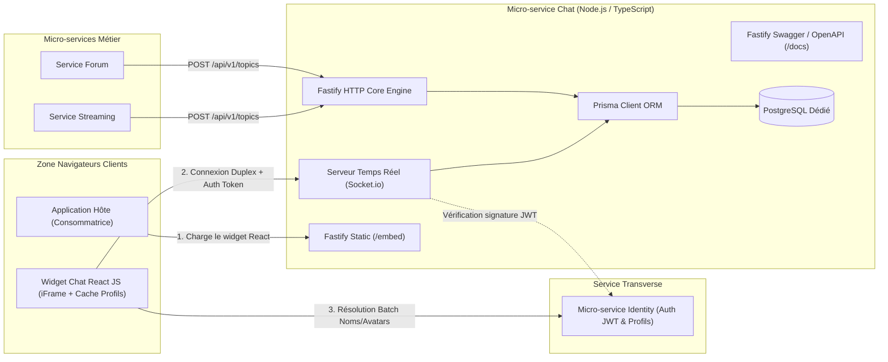
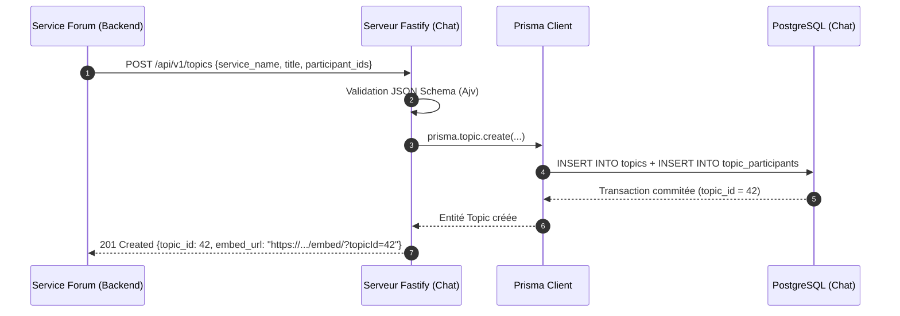
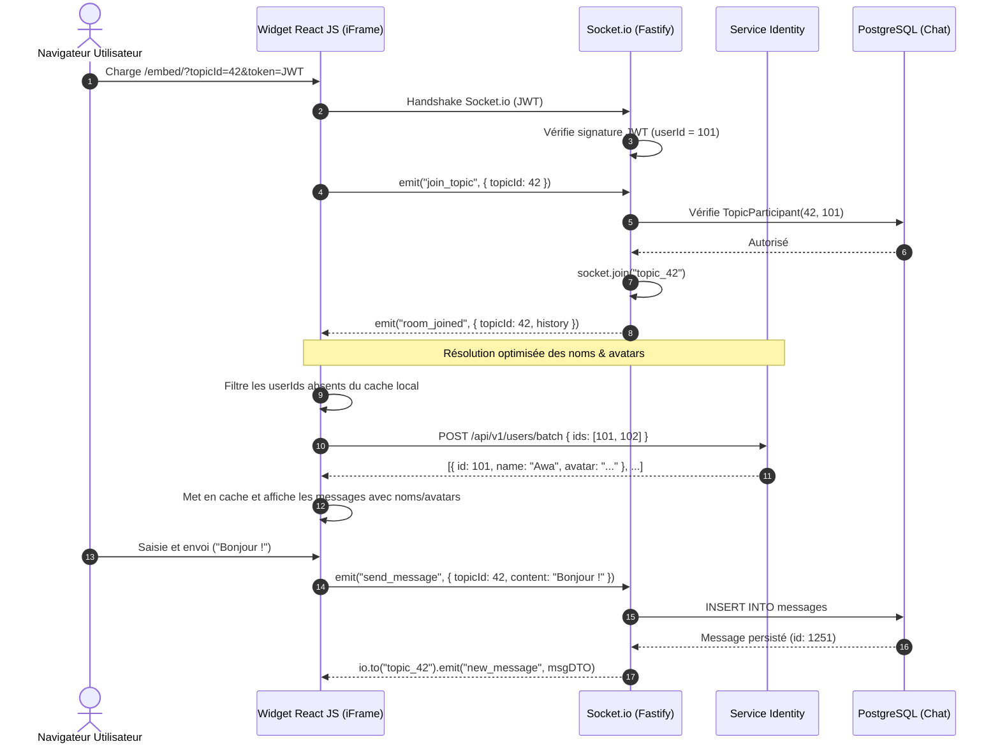

# Spécification Technique d'Architecture — Micro-service Chat

## 1. Présentation Générale & Périmètre

Le présent document formalise l'architecture logicielle, le schéma de données relationnel, les interfaces de programmation et les principes de conception du **micro-service Chat**.

Dans un écosystème distribué orienté micro-services, ce composant fournit une brique transverse et autonome de messagerie instantanée. Il est conçu pour être consommé par les autres services applicatifs du système (modules de forum, plateformes d'apprentissage, streaming, etc.) tout en observant un strict découplage fonctionnel :

* **Responsabilité unique** : Gestion exclusive des espaces de discussion (*Topics*), du contrôle d'accès aux salons privés, de la distribution en temps réel et de l'historisation des messages.
* **Délégation d'identité et d'affichage** : Le micro-service ne stocke aucun compte d'utilisateur, mot de passe, nom d'affichage ni avatar. Il opère exclusivement sur la base d'identifiants (`user_id`) émis par le service central `Identity`. La résolution des noms et avatars s'effectue par agrégation côté client auprès de `Identity`.
* **Cloisonnement multi-tenant** : Les discussions des différents services appelants sont isolées logiquement par le couple `(service_name, topic_id)`.
* **Modes d'intégration offerts** :
  1. **Mode API REST & WebSocket (Headless)** : Exposition programmatique complète via Fastify et Socket.io (création de salons, gestion des membres, émission et écoute des événements).
  2. **Mode Widget UI Embarqué (iFrame)** : Application cliente légère construite avec **React (JavaScript) + Vite**, compilée en ressources statiques et servie par Fastify sous forme de composant intégrable par simple balise HTML `<iframe>`.

---

## 2. Architecture Système Globale

Le schéma ci-dessous détaille le positionnement du micro-service Chat, l'agrégation des profils utilisateurs côté navigateur et le découpage interne sous Node.js (**TypeScript**, **Fastify**, **Socket.io**, **Prisma ORM**).



---

## 3. Justification des Choix Techniques

### 3.1. Moteur Backend : Fastify (TypeScript / Node.js)

1. **Performances et faible latence** : Fastify optimise la sérialisation JSON via `fast-json-stringify`, réduisant la surcharge processeur sur les flux d'API.
2. **Documentation interactive native (`@fastify/swagger` + `@fastify/swagger-ui`)** : Grâce aux schémas JSON Schema associés aux routes, Fastify génère automatiquement une interface Swagger interactive consultable sur `/docs`.
3. **Validation automatique des requêtes** : Les schémas de validation intégrés (Ajv) rejettent immédiatement tout payload non conforme avec un code HTTP 400 documenté.
4. **Typage strict de bout en bout** : Le backend est écrit en **TypeScript**, garantissant la cohérence entre le client généré par Prisma, les routes Fastify et les événements Socket.io via un contrat partagé (`shared/contracts.ts`).

### 3.2. Moteur Temps Réel : Socket.io

* **Gestion native des « Rooms » (Salons privés)** : L'isolation des messages par topic est assurée nativement via `socket.join("topic_<id>")` et la diffusion ciblée avec `io.to("topic_<id>").emit(...)`.
* **Résilience réseau** : Reconnexion automatique, détection de coupure par heartbeat et repli automatique (*fallback*) en HTTP Long-Polling.

### 3.3. Frontend Embarqué : React (JavaScript) + Vite

* **Réactivité UI sans serveur additionnel** : React gère proprement les mises à jour d'état temps réel (ajout de messages, bascule visuelle lors d'un *soft-delete*, indicateurs de connexion). Compilé avec **Vite** en fichiers statiques (`HTML/CSS/JS`), il est servi directement par Fastify sur `/embed/` sans nécessiter de conteneur ou serveur Node supplémentaire.
* **Productivité d'équipe** : Le code frontend est rédigé en JavaScript standard (`.jsx`/`.js`) tout en bénéficiant de l'autocomplétion sur les contrats backend grâce aux annotations JSDoc pointant vers `shared/contracts.ts`.

### 3.4. Agrégation des Profils Utilisateurs Côté Client (Pattern UI Composition)

Plutôt que de dupliquer les noms et avatars dans la base du micro-service Chat (ce qui introduirait des problèmes de synchronisation et violerait le principe de source unique de vérité), la résolution des identités suit une stratégie d'agrégation côté client optimisée :

1. **Requêtage groupé (*Batching*)** : À l'ouverture d'un salon, le widget React extrait la liste des `participantIds` uniques et effectue **une seule requête HTTP groupée** vers `Identity` (`POST /api/v1/users/batch` avec `{ ids: [...] }`), évitant le problème des requêtes $N+1$.
2. **Mise en cache de session (`sessionStorage` / Contexte React)** : Les profils résolus (`{ name, avatar }`) sont conservés en mémoire dans un dictionnaire indexé par `userId`. Lors d'un changement de salon, seuls les identifiants absents du cache sont interrogés auprès d'`Identity`.
3. **Affichage optimiste et repli gracieux (*Graceful Fallback*)** : Les bulles de messages s'affichent immédiatement avec un libellé de repli (`Utilisateur #<id>`) et des initiales génériques pendant le chargement asynchrone, garantissant que l'affichage du chat n'est jamais bloqué en cas de latence ou d'indisponibilité temporaire d'`Identity`.

---

## 4. Modélisation des Données

Le micro-service applique le patron **Database-per-service** : il possède sa propre instance PostgreSQL isolée ne contenant aucune donnée personnelle utilisateur.

### 4.1. Schéma Déclaratif Prisma (`schema.prisma`)

```prisma
datasource db {
  provider = "postgresql"
  url      = env("DATABASE_URL")
}

generator client {
  provider = "prisma-client-js"
}

model Topic {
  id           Int                @id @default(autoincrement())
  serviceName  String             @map("service_name") @db.VarChar(64)
  title        String             @db.VarChar(255)
  createdAt    DateTime           @default(now()) @map("created_at")
  participants TopicParticipant[]
  messages     Message[]

  @@index([serviceName])
  @@map("topics")
}

model TopicParticipant {
  topicId   Int      @map("topic_id")
  userId    Int      @map("user_id")
  joinedAt  DateTime @default(now()) @map("joined_at")
  topic     Topic    @relation(fields: [topicId], references: [id], onDelete: Cascade)

  @@id([topicId, userId])
  @@index([userId])
  @@map("topic_participants")
}

model Message {
  id        BigInt   @id @default(autoincrement())
  topicId   Int      @map("topic_id")
  senderId  Int      @map("sender_id")
  content   String   @db.Text
  isDeleted Boolean  @default(false) @map("is_deleted")
  createdAt DateTime @default(now()) @map("created_at")
  topic     Topic    @relation(fields: [topicId], references: [id], onDelete: Cascade)

  @@index([topicId, createdAt(sort: Desc)])
  @@map("messages")
}
```

---

## 5. Spécification des Interfaces & Contrats d'API

### 5.1. Contrat Partagé (`shared/contracts.ts`)

```typescript
export interface MessageDTO {
  id: number;
  topicId: number;
  senderId: number;
  content: string;
  isDeleted: boolean;
  createdAt: string;
}

export interface TopicDTO {
  id: number;
  serviceName: string;
  title: string;
  participantIds: number[];
}

export interface ServerToClientEvents {
  room_joined: (payload: { topicId: number; history: MessageDTO[] }) => void;
  new_message: (message: MessageDTO) => void;
  message_deleted: (payload: { messageId: number; topicId: number }) => void;
  error_event: (payload: { code: string; message: string }) => void;
}

export interface ClientToServerEvents {
  join_topic: (payload: { topicId: number }) => void;
  send_message: (payload: { topicId: number; content: string }) => void;
  delete_message: (payload: { topicId: number; messageId: number }) => void;
}
```

### 5.2. Endpoints REST HTTP (Fastify)

Toutes les routes d'API sont préfixées par `/api/v1` et documentées sur `/docs`.

* **`POST /api/v1/topics`** : Crée un salon privé (`{ service_name, title, participant_ids }`) et retourne `{ topic_id, embed_url }`.
* **`POST /api/v1/topics/:topic_id/participants`** : Ajoute une liste d'identifiants `{ user_ids }` au salon.
* **`DELETE /api/v1/topics/:topic_id/participants/:user_id`** : Révoque l'accès d'un participant.
* **`GET /api/v1/topics/:topic_id/messages`** : Retourne l'historique paginé (`?limit=50&before_id=...`).
* **`DELETE /api/v1/messages/:message_id`** : Applique un effacement logique (`is_deleted = true`).

### 5.3. Protocole Temps Réel (Socket.io)

Lors de la connexion sur `/socket.io/`, le client transmet son jeton JWT (`auth: { token }`). Le middleware vérifie la signature cryptographique et contrôle l'appartenance au salon :

$$
\text{Accès autorisé} \iff \text{TopicParticipant}(topic\_id, user\_id) \neq \emptyset
$$

---

## 6. Flux d'Interaction & Diagrammes de Séquence

### 6.1. Flux 1 : Création d'un Salon par un Micro-service Tiers



### 6.2. Flux 2 : Chargement Widget iFrame, Résolution des Profils & Messagerie



---

## 7. Sécurité & Cloisonnement

1. **Contrôle d'intégrité de l'émetteur** : L'identifiant `senderId` est extrait exclusivement du jeton JWT vérifié lors du handshake Socket.io, empêchant toute usurpation d'identité.
2. **Protection contre le Clickjacking** : L'exposition du widget `/embed/` est restreinte via l'en-tête HTTP `Content-Security-Policy: frame-ancestors 'self' https://*.domain.local`.
3. **Isolation des données personnelles** : Aucune donnée nominative (nom, email, avatar) n'est stockée dans PostgreSQL côté Chat, limitant la surface d'exposition des données personnelles.

---

## 8. Grille d'Arbitrage & Réponses pour la Revue Technique

| Axe d'Évaluation | Positionnement & Argumentation Technique |
| :--- | :--- |
| **Pourquoi ne pas stocker les noms et avatars en base Chat ?** | Respect du principe de *Source Unique de Vérité* : `Identity` détient les profils. Les résoudre côté client par requêtes groupées (*batch*) avec cache de session évite la duplication de données et toute désynchronisation lors d'une mise à jour de profil. |
| **Pourquoi le couple Fastify (TS) + Socket.io ?** | Fastify offre une validation JSON Schema native et une documentation Swagger automatique sur `/docs`, tandis que Socket.io gère nativement le cloisonnement en salons privés (*rooms*). |
| **Pourquoi un backend TypeScript et un frontend React JS ?** | TypeScript sécurise la couche d'accès PostgreSQL (Prisma) et les événements temps réel via `shared/contracts.ts`. React compilé en statique par Vite offre une interface réactive servie directement par Fastify sans serveur frontend dédié. |
| **Comment le service reste-t-il résilient si Identity ralentit ?** | La validation des jetons JWT est stateless (vérification cryptographique locale) et le widget UI applique un repli gracieux (`Utilisateur #ID`) si l'appel batch des profils tarde à répondre. |